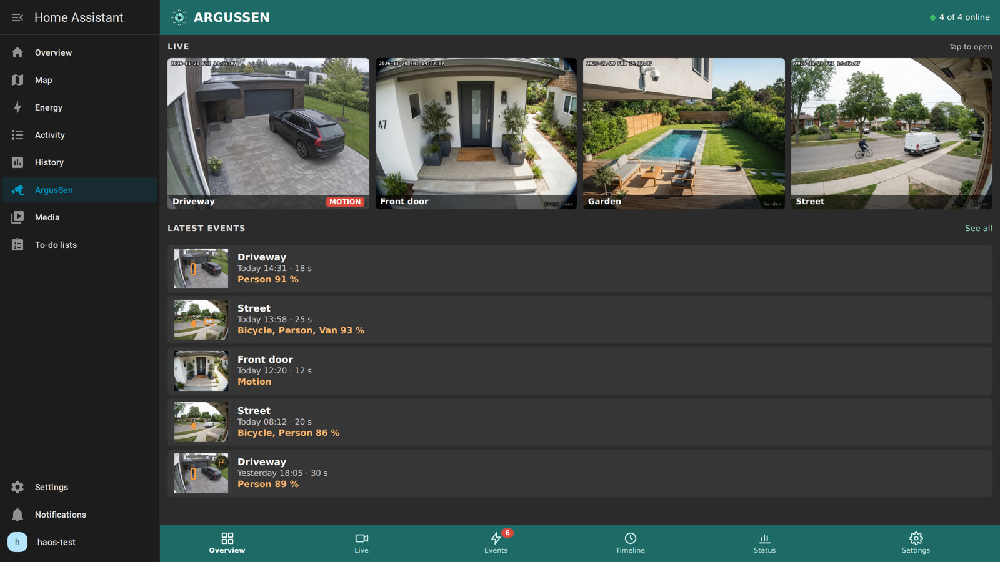
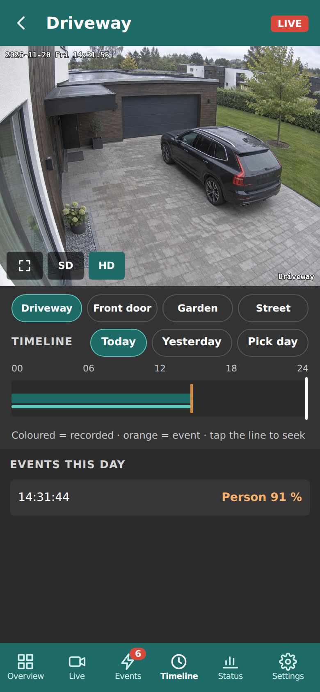
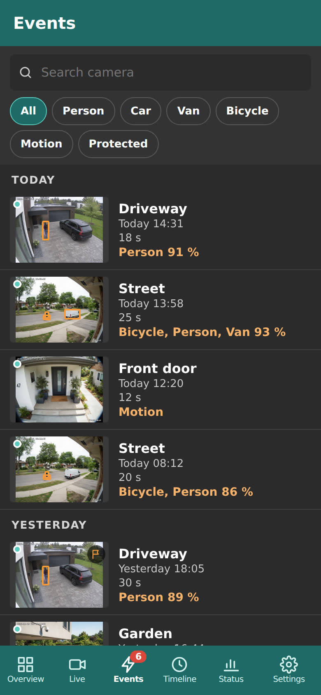
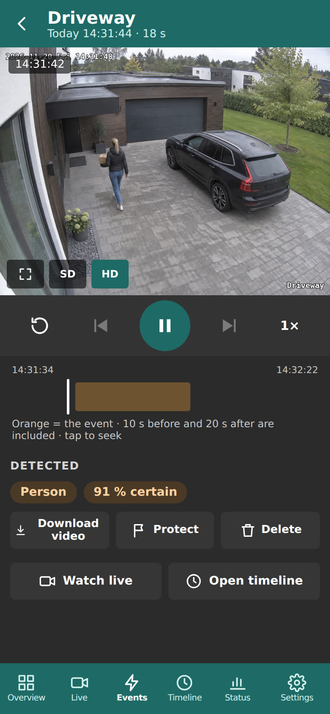
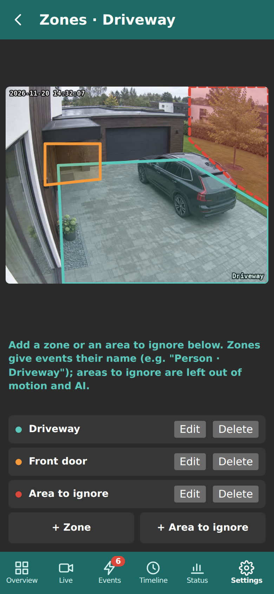
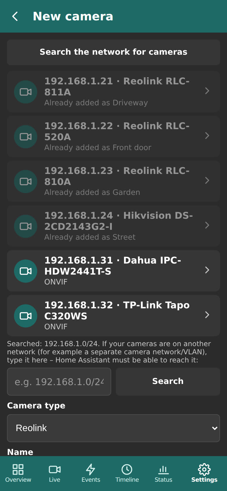

<p align="center"></p>

# ArgusSen – NVR for Home Assistant

ArgusSen is a lightweight network video recorder (NVR) that runs as a **Home Assistant app**.
It records your cameras 24/7, detects people, cars, vans and bicycles with AI, and shows live
video, a timeline and events right in the Home Assistant sidebar. Everything stays on your own
hardware – no cloud and no subscription.

<p align="center"><a href="https://buymeacoffee.com/argussen"></a></p>

> **Version 1.1** – now with **zones**, a **notification blueprint**, **device triggers** and an **"Active" switch** per
> camera ([what's new](argussen/CHANGELOG.md)). Tested on a home installation with Reolink and D-Link cameras;
> feedback and bug reports are welcome under *Issues*.

<p align="center"></p>

<table>
  <tr>
    <td align="center"><br><sub>Live and 24/7 timeline</sub></td>
    <td align="center"><br><sub>Events with AI and zones</sub></td>
    <td align="center"><br><sub>Playing an event</sub></td>
    <td align="center"><br><sub>Zones (new in 1.1)</sub></td>
    <td align="center"><br><sub>Find cameras on the network</sub></td>
  </tr>
</table>

<sub>The camera pictures in the screenshots are made-up demo scenes, not a real home.</sub>

## Features

- **24/7 recording** in two qualities: low resolution (SD) for days, full resolution (HD) for
  hours – and kept longer around events.
- **Events with AI**: person, car, van, bicycle – with snapshot, the video before and after,
  download as MP4, and "protect" so it is never deleted.
- **Zones**: up to 3 zones and 3 areas to ignore per camera, drawn on the camera picture. Events show where
  something happened ("Person · Driveway"), and areas to ignore (a road, a tree in the wind) give fewer false events.
- **Live view and timeline** with zoom, speed from ½× to 64× and jumping between cameras. On a PC the live view
  fills the screen and the timeline shows the day's events next to the video.
- **Your own camera order** – drag the cameras into place in the overview.
- **Find cameras on the network** (ONVIF discovery and RTSP) when adding a camera.
- **Login through Home Assistant** – no extra users or passwords. HA administrators are ArgusSen
  administrators; others can be limited to certain cameras.
- **Storage on Home Assistant's disk or a NAS**, chosen inside ArgusSen, with an optional limit for how much space
  ArgusSen may use – the oldest recordings are deleted first, never protected events. If the NAS stops
  responding, recording continues locally and is moved to the NAS when it is back.
- **Built-in AI (optional)** using [Blue Onyx](https://github.com/xnorpx/blue-onyx) and ONNX
  Runtime – or use your own Blue Onyx / CodeProject.AI server, or no AI at all.
- **A real Home Assistant integration** – set up with one click: cameras with live video for every
  Home Assistant card, motion and person/car/van/bicycle sensors, a sensor per zone, event entities, the
  latest event, a "home mode" switch, an **"Active" switch per camera**, and event recordings in Home Assistant's
  media browser. Also for ArgusSen on a separate server (via HACS).
- **Easy automations**: device triggers such as *"Person detected"* or *"Person came into Driveway"*, and a
  **blueprint** that sends a notification with the camera picture to your phone – no YAML needed.
- **Seven languages**: English, German, French, Danish, Swedish, Norwegian and Dutch – both the app
  and the entity names in Home Assistant.
- **Light**: written in Go; a few percent of one CPU core for several cameras (without AI).

## Requirements

- Home Assistant OS or Supervised (apps are not available on Container/Core installations).
- Network cameras (wired or wifi) with a main stream and a sub stream: **Reolink** (optimised, with Reolink's own
  protocol), **ONVIF** cameras (most other brands – the streams are found automatically) or any camera with
  **RTSP** addresses (presets for Hikvision, Dahua, Axis, TP-Link, Uniview and Foscam). H.264 or H.265 – H.265 plays on devices that can decode it.
- Built-in AI: a fairly fast machine – tested on 64-bit PCs (amd64). It is also built for Raspberry Pi
  (aarch64), but is slow there and not tested yet; `external` (your own AI server) or `none` also work.

## Installation

[](https://my.home-assistant.io/redirect/supervisor_add_addon_repository/?repository_url=https%3A%2F%2Fgithub.com%2FArgusSen%2Fargussen)

Or manually:

1. In Home Assistant go to **Settings → Apps → App store**, open the menu (⋮) → **Repositories**.
2. Add `https://github.com/ArgusSen/argussen`.
3. Find **ArgusSen** in the store and install it. Turn on **Show in sidebar** and start it.
4. Open **ArgusSen** in the sidebar and add your cameras under *Settings → Cameras* – *Search the network for
   cameras* finds them for you.

See the [app documentation](argussen/DOCS.md) for configuration, storage and AI.

## How it works

ArgusSen connects to each camera once per stream and uses the same connection for recording,
live view and motion detection. Recordings are stored as one-minute MPEG-TS files; nothing is
re-encoded. When motion is seen, a frame is sent to the AI about once per second. Events,
users and settings are stored in a small SQLite database in the app's data folder (included in
Home Assistant backups – the recordings themselves are not).

## Building from source

Everything is in the app folder `argussen/`, and its `Dockerfile` builds it all from source – the server, the
built-in AI (Blue Onyx at a fixed commit, ONNX Runtime from Microsoft's official wheel, checked with SHA-256)
and the app image. The GitHub workflow builds a ready multi-arch image for amd64 and aarch64 (`ghcr.io/argussen/argussen`),
which Home Assistant downloads.

| Folder | Contents |
|---|---|
| `argussen/` | The Home Assistant app (Dockerfile, configuration, documentation) |
| `argussen/server/` | The ArgusSen server (Go, no cgo) |
| `argussen/web/` | The user interface (plain HTML/JS) |
| `argussen/i18n/` | Translations – see [argussen/i18n/README.md](argussen/i18n/README.md) to add or fix a language |
| `argussen/ai/` | How the built-in AI is built – see [argussen/ai/README.md](argussen/ai/README.md) |

```sh
cd argussen/server && CGO_ENABLED=0 go build -o argus . && go test ./...
python3 argussen/i18n/build.py   # after changing a translation
```

## Coming: ArgusSen as a standalone server

ArgusSen started as a recorder on its own small Linux server, and that is where it is going next as well: a
**standalone server version** for those who do not run Home Assistant OS, or want the recorder on a separate
machine. It will be the same ArgusSen – recording, events, live view, the timeline and the web interface – with
the **built-in AI** included. It will run as a Docker container or directly on Linux, with its own users and
logins, and can still be connected to Home Assistant with the integration from HACS.

This is planned, not ready yet – follow the releases here to hear when it is.

## License

[MIT](LICENSE). ArgusSen uses other open-source projects – see
[THIRD_PARTY_NOTICES.md](THIRD_PARTY_NOTICES.md). Special thanks to
[Blue Onyx](https://github.com/xnorpx/blue-onyx) for the AI server.

ArgusSen is an independent project and is not affiliated with Reolink or Home Assistant.

## Support ArgusSen

ArgusSen is free and open source, and it will stay that way. It is made in spare time, and every new camera brand
means buying a camera to test with. If ArgusSen keeps an eye on your home, a coffee is a lovely way to say thanks:

<a href="https://buymeacoffee.com/argussen"></a>
